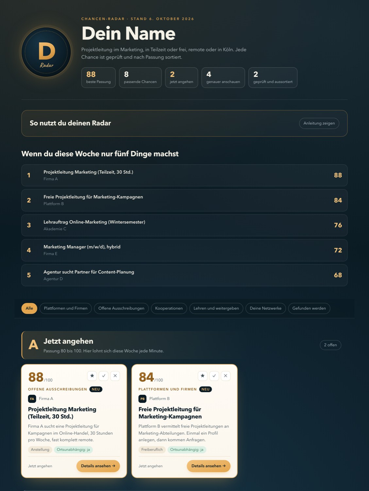
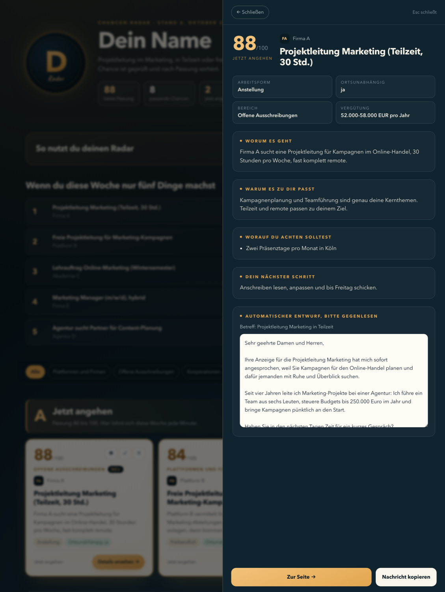

# Chancen-Radar

Dein persönlicher Such-Agent für Jobs, Aufträge und Kooperationen.
Er sucht jede Woche für dich, bewertet jede Chance mit 0 bis 100 Punkten und schreibt dir für die besten gleich eine Nachricht vor.

Er läuft auf deinem Mac. Die KI rechnet lokal und kostenlos. Dein Lebenslauf bleibt auf deinem Rechner.



## Was du davon hast

- **Alles auf einer Seite.** Jeden Montag die neuen Funde aus vielen Quellen, sortiert nach Passung.
- **Jede Chance mit Begründung.** Warum sie passt, was verlangt wird, worauf du achten solltest.
- **Erste Entwürfe.** Für die besten Funde liegt ein Entwurf bereit. Richtig gute Anschreiben schreibt dir Claude auf Zuruf, mit deinem ganzen Profil im Kopf.
- **Mehr als Stellenanzeigen.** Er findet auch Plattformen, Kooperationen, Lehraufträge und Verzeichnisse, die auf keiner Jobbörse stehen.



## In drei Schritten zu deinem Radar

1. Klick oben rechts auf **Use this template** → **Create a new repository** und wähle **Private**. Ohne GitHub-Konto: **Code** → **Download ZIP**.
2. Öffne den Ordner in [Claude Code](https://claude.com/claude-code).
3. Sag: **„Richte meinen Radar ein."**

Claude stellt dir dann die Fragen aus dem [Fragebogen](FRAGEBOGEN.md): was du suchst, wer du bist, dein Lebenslauf, deine Grenzen. Daraus baut es dein Profil und installiert alles gemeinsam mit dir. Programmieren musst du nicht. Rechne mit etwa 30 Minuten, danach läuft der erste Suchlauf.

## Was du brauchst

| Was | Wofür | Kosten |
|---|---|---|
| Mac mit Apple-Chip (M1 oder neuer) | die lokale KI (8 GB Arbeitsspeicher gehen, 16 GB sind angenehmer) | |
| [Claude Code](https://claude.com/claude-code) | richtet alles mit dir ein und passt den Radar später an | braucht ein Claude-Abo |
| [Ollama](https://ollama.com/download) | die lokale KI, die bewertet und schreibt | kostenlos |
| [Firecrawl](https://www.firecrawl.dev) (optional) | Websuche nach Plattformen und Kooperationen | Gratis-Plan mit 1.000 Credits im Monat reicht für einen Lauf pro Woche |
| ntfy-App (optional) | Nachricht aufs Handy, wenn es Neues gibt | kostenlos |

## So läuft ein Suchlauf

| Schritt | Was passiert |
|---|---|
| 1. Suchen | LinkedIn und Indeed nach deinen Suchbegriffen, dazu die Firecrawl-Websuche ([alle Quellen](QUELLEN.md)) |
| 2. Aussieben | Stellen, die nur vor Ort gehen, fliegen raus (nur wenn du ausschließlich remote arbeiten willst) |
| 3. Bewerten | Die lokale KI gibt jeder Chance 0 bis 100 Punkte, mit Begründung |
| 4. Schreiben | Ab 70 Punkten ein erster Entwurf: Anschreiben für Stellen, kurze Nachricht für alles andere |
| 5. Zeigen | Alles landet auf deiner Radar-Seite, mit den Funden der letzten 35 Tage |
| 6. Melden | Auf Wunsch eine Nachricht aufs Handy |

- **Von selbst:** jeden Montag um 6 Uhr (der Mac muss an sein).
- **Sofort:** Doppelklick auf `Chancen suchen.command`.
- **Ansehen:** Doppelklick auf `Radar oeffnen.command`.

Ein Lauf dauert 10 bis 60 Minuten. Bewertete Links merkt sich der Radar, du siehst jede Woche nur Neues.

## Anpassen

Fast alles steckt in einer Datei: `data/profile.json`. Du musst sie nicht selbst bearbeiten. Sag Claude einfach, was du willst:

- „Such zusätzlich nach Lehraufträgen in Österreich."
- „Zeig mir keine Vollzeitstellen mehr."
- „Die Nachrichten sollen per du sein."
- „Mach den Radar in meinen Farben."
- „Schreib mir für die drei besten Chancen dieser Woche richtig gute Anschreiben."
- „Recherchiere zehn Chancen von Hand und trag sie in meinen Radar ein."

Wo was steht, weiß Claude aus der [CLAUDE.md](CLAUDE.md).

## Deine Daten

Profil, Lebenslauf, Antworten und Funde liegen in `data/` und `docs/index.html`. Beides ist von Git ausgeschlossen und bleibt auf deinem Rechner, auch wenn du deine Kopie auf GitHub speicherst. Die KI läuft lokal über Ollama. Nach außen gehen nur deine Suchbegriffe (an LinkedIn, Indeed und Firecrawl).

## Wenn etwas hakt

- `python3 scripts/doctor.py` zeigt in Ampelfarben, was fehlt. Oder frag Claude: „Prüf meinen Radar."
- Indeed antwortet nicht (Timeout oder Fehler 403): in `.env` die Zeile `JOBSPY_SITES=linkedin` setzen.
- macOS blockiert den Doppelklick („nicht verifizierter Entwickler"): Rechtsklick auf die Datei → **Öffnen** → **Öffnen**. Das ist nur beim ersten Mal nötig.
- Keine neuen Treffer: In ruhigen Wochen normal. Der Radar zeigt weiter die Funde der letzten 35 Tage.
- Texte zu schwach: größeres Modell nehmen, in `.env` `LLM_MODEL=qwen2.5:14b` und einmal `ollama pull qwen2.5:14b`.

## Optional: Radar online mit Passwort

Du willst deinen Radar auch unterwegs auf dem Handy sehen? Claude stellt ihn mit dir auf [Vercel](https://vercel.com) online (kostenloser Plan), geschützt mit einem Passwort. Sag: „Stell meinen Radar mit Passwort online." Die Technik liegt schon bereit (`middleware.js`, `vercel.json`).

## Von Hand einrichten (ohne Claude Code)

```bash
./scripts/install.sh
cp data/profile.example.json data/profile.json
python3 scripts/doctor.py
./scripts/run_daily.sh
```

Nach dem Kopieren `data/profile.json` mit deinen Angaben füllen. Die Fragen dazu stehen im [Fragebogen](FRAGEBOGEN.md).

## Fair nutzen

Der Radar nutzt die offene Bibliothek [JobSpy](https://github.com/speedyapply/JobSpy) für LinkedIn und Indeed. Such in Maßen (einmal pro Woche reicht), nutze die Ergebnisse nur für dich und beachte die Nutzungsbedingungen der Seiten. Die Punkte sind eine Einschätzung der KI. Lies Anforderungen immer auf der Originalseite nach.

## Lizenz

MIT. Du darfst den Radar frei nutzen, verändern und weitergeben.

Gebaut von [Ilja Krasevskij](https://www.linkedin.com/in/iljakrasevskij). Ideen oder Fehler? Schreib gern ein [Issue](https://github.com/IljaSabalaKrasevskij/chancen-radar/issues).
